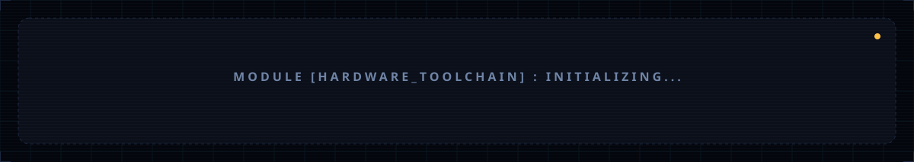
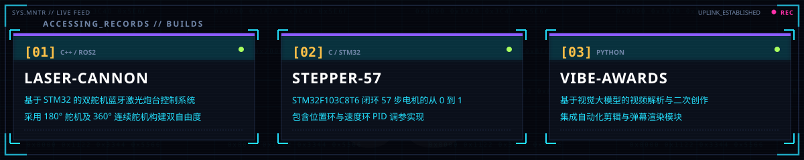
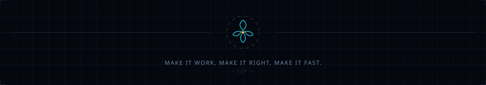

<!-- 
  JASMINE//OS BOOT SEQUENCE INITIATED 
  WARNING: TERMINAL REQUIRES 1200PX CLEARANCE 
-->

  <picture>
    <source media="(prefers-color-scheme: dark)" srcset="assets/01_hero.svg">
    <source media="(prefers-color-scheme: light)" srcset="assets/01_hero.svg">
    
  </picture>
   
  <picture>
    
  </picture>
   
  <picture>
    
  </picture>
   
  <picture>
    
  </picture>
   
  <picture>
    
  </picture>
   
  <picture>
    
  </picture>

<!-- 
SEO / ACCESSIBILITY DATA (Hidden to match visual constraints)
JasmineX | STM32 | ROS2 | C++ | Python | Motion Control
Make it work, make it right, make it fast.
-->
